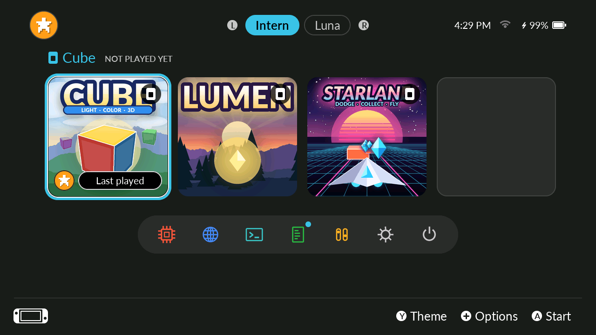
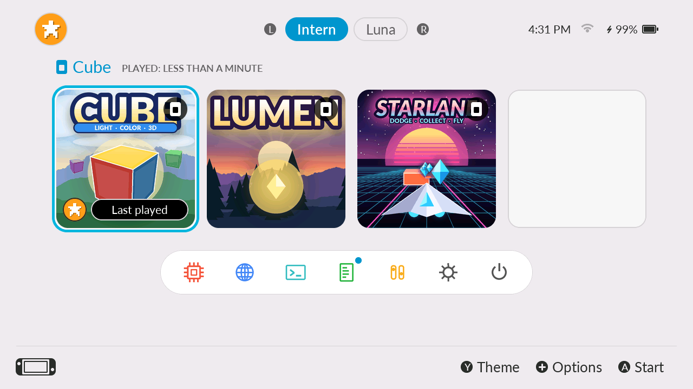
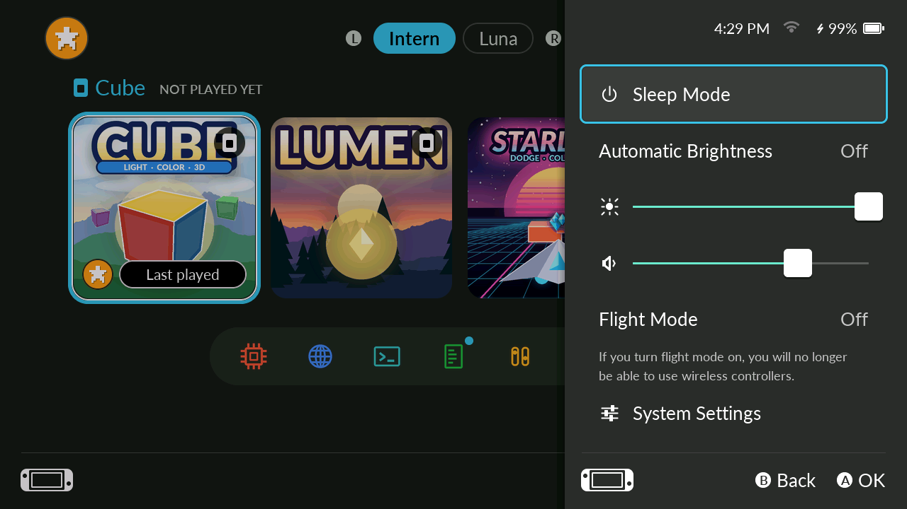
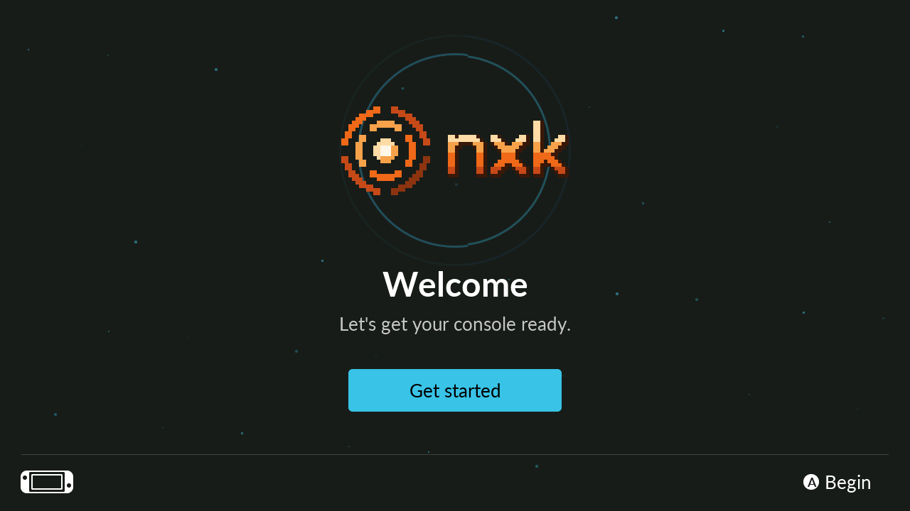
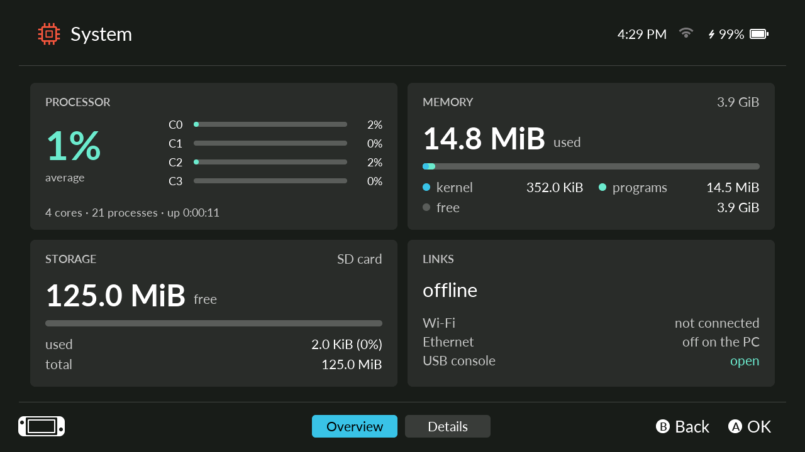
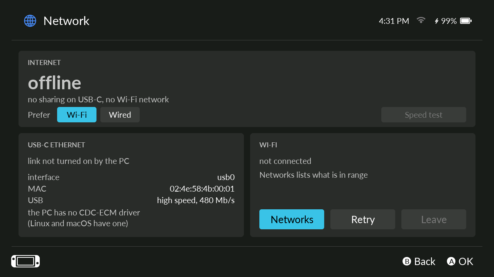
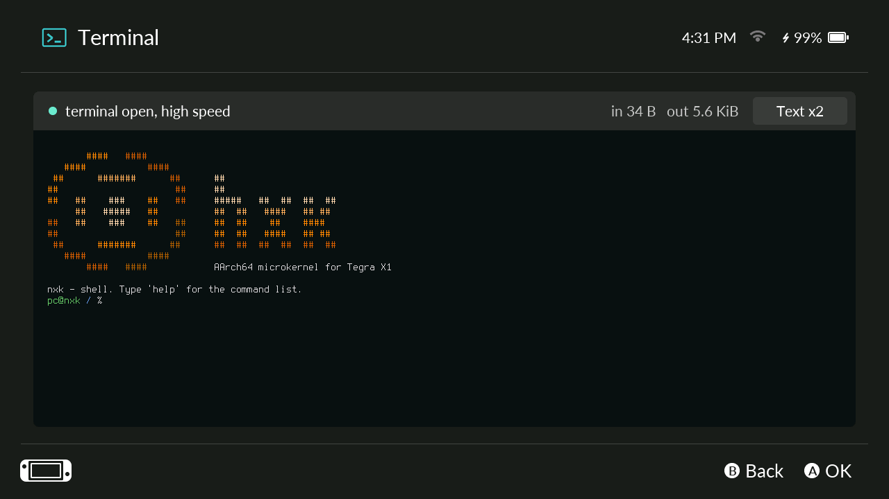
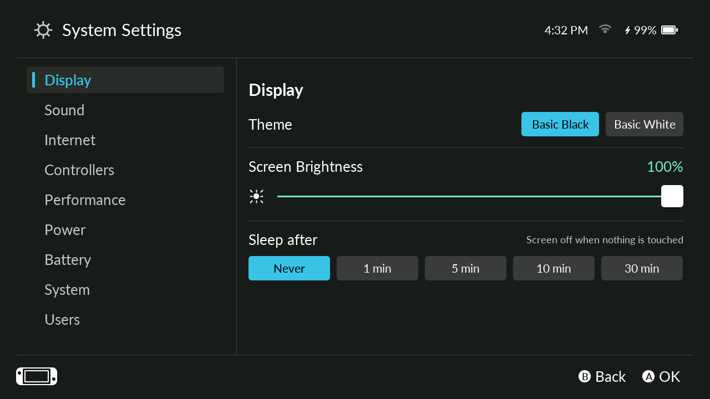
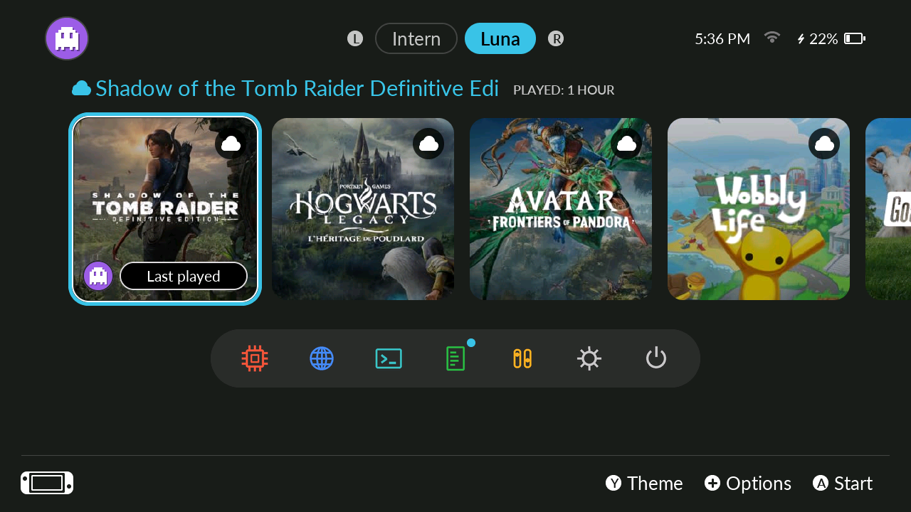
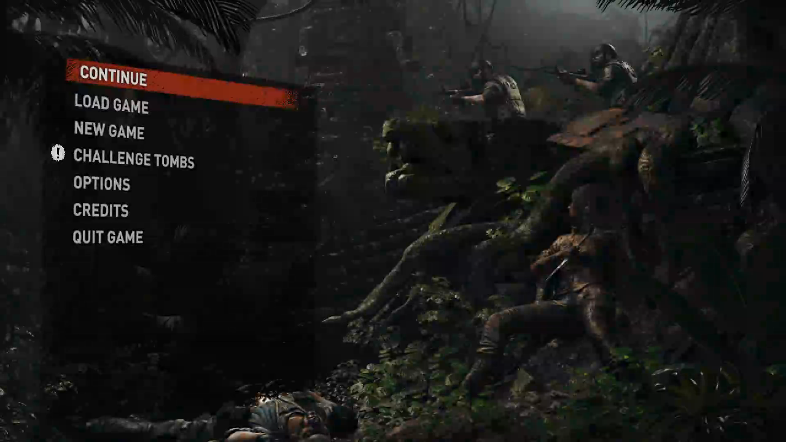

  <picture>
    <source media="(prefers-color-scheme: dark)" srcset="docs/logo/nxk-logo-dark.svg">
    
  </picture>

# nxk — AArch64 microkernel for Tegra X1

nxk turns a Nintendo Switch (Tegra X1, Erista and Mariko) into its own
video game console. It is a microkernel written **entirely in Rust**,
with no host OS: the kernel keeps only memory, threads, scheduling, IPC
and capabilities, and everything else (drivers, files, network, the
screen) runs as ordinary programs. The screen is a game library with
users, settings and system pages; games are ordinary Rust programs
drawing with the GPU's 3D engine through a small SDK; cloud games
stream from Amazon Luna. It boots on a real Erista by itself, from its own RCM launcher (`nxk-ipl`), with no hekate.

Building, running, testing and the design: [DEV.md](DEV.md).

## Features

| Feature | Status | Details |
|---|---|---|
| Game library | ✅ Complete | `/games` library with touch (drag and flick the row) and gamepad, HOME to leave a game, cover art |
| User management | ✅ Complete | First-start setup, avatar, theme and PIN per user, Users page, saves and play time per user |
| Settings and system pages | ✅ Complete | Quick settings, System Settings, System, Network, Terminal and Logs pages; dark and light themes |
| Sleep mode | ✅ Complete | Screen and GPU rail off, services suspended; sleep and wake with the Power button, validated on the Erista |
| SDK `nxgfx` | ✅ Complete | GPU command streams, meshes, 2D canvas, input, audio |
| 3D engine and shaders | 🟡 Partial | Shader compiler, depth, textures and compute ray queries; instanced and fullscreen draws not yet run on the console |
| GPU | 🟡 Partial | Secure boot, 2D, compute and 3D; clock steps from 76.8 to 921.6 MHz run on the Erista; mipmaps not yet run on the console |
| Games | ✅ Complete | Cube, Lumen and Starlane; Lumen (ray-traced shadows) and Starlane run on the Erista at 60 fps; Cube is a small demo |
| Audio | 🟡 Partial | 16-bit stereo 48 kHz on the speakers; clean sound while a game runs, headphones, capture and mixing to do |
| Amazon Luna | 🟡 Partial | Sign-in by code, the account's games, H.264 video and Opus audio, performance overlay; 60 Hz not reached (45 Hz by default) |
| Boot on Erista | ✅ Complete | From `nxk-ipl`, nxk's own RCM payload (no hekate), then `nxk-bl31`: DRAM training, 4 cores, PSCI, shell over USB-C, SD card |
| Boot on Mariko | ⏳ To do | Emulated (`tegrax1plus`); not yet tested on a Mariko, and no USB-C console there (its OTG port belongs to XUSB) |
| Memory | ✅ Complete | On demand, W^X, `mprotect`, shared memory, DMA buffers, ASLR, reserved areas |
| Threads and scheduling | 🟡 Partial | Priorities, affinity, migration, balancing, tickless, futex; deep sleep states to do |
| IPC | 🟡 Partial | Synchronous, timeouts, handles, notifications, pipes, sender identity; waiting on several objects (`poll`) to do |
| Programs | ✅ Complete | Static-PIE ELF, arguments, environment, TLS, loading from the SD card; dynamic linking ruled out |
| Rust (`no_std` and `std`) | 🟡 Partial | `std` covers FAT32 files, threads, synchronization, IPv4 TCP and UDP, processes; panic unwinding, backtraces, IPv6 and some file APIs to do |
| Security | ✅ Complete | Capabilities, revocation, Spectre v2 mitigation, isolation |
| Tools | ✅ Complete | Build, SD card image, tests, gdb, L4T comparison, USB-C terminal |
| Base drivers | ✅ Complete | UART, I2C, PMIC, RTC, temperatures |
| Screen | ✅ Complete | InnoLux 720x1280 panel started by `nxk-ipl`, backlight and sleep; JDI and AUO power-down tables untested |
| Boot screen | 🟡 Partial | nxk logo and progress bar from the monitor to the library, logs with Vol+ held; checked pixel for pixel in the emulator, not yet seen on the Erista |
| Touchscreen | ✅ Complete | FTM3BD56, read on its interrupt line, polled as a fallback |
| Fan | ✅ Complete | Temperature curve as in Nyx, speed read from the tachometer |
| Joy-Con | 🟡 Partial | Left Joy-Con works on the Erista; right one not detected; charging and rumble to do |
| Power and volume buttons | 🟡 Partial | Power sleep and wake validated on the Erista; volume buttons not yet checked by hand |
| Battery | 🟡 Partial | Gauge (charge, voltage, health) and charger read on the Erista; the charge still falls under nxk on a PC's USB-C port |
| CPU clock | 🟡 Partial | PLLX steps up to about 1224 MHz on the Erista; faster steps need the DFLL, not written yet |
| DRAM clock | 🟡 Partial | Switches between 204, 408 and 800 MHz validated on the Erista; 1331 and 1600 MHz need periodic training, not ported |
| USB device | ✅ Complete | Serial console and terminal over USB-C; `usb0` network shared by the PC, validated on the Erista |
| USB host | 🟡 Partial | Keyboard and USB Ethernet adapter work in the emulator; on the Erista the xHCI is left unpowered, and it needs NVIDIA firmware |
| Storage | 🟡 Partial | SD card (64 GB read and written on the Erista), FAT32, file API; eMMC and ext4 to do |
| Game card reader | 🟡 Partial | Cartridge detect, ASIC power, reset and SDMMC2 bring-up up to the ASIC's bootrom (`gc probe`, Tools page); reading a cartridge needs Nintendo's signed ASIC firmware and the console's keys, not available to nxk |
| Network | 🟡 Partial | TCP, UDP, DNS, DHCP, sockets, switching between links; IPv6 to do |
| Wi-Fi | 🟡 Partial | Scans, open and WPA2-Personal joins, traffic on `wlan0`; the chip still resets itself at times (cause unknown), and `wlan` brings it back; WPA (TKIP), WPA3 and mixed WPA/WPA2 refused |
| Bluetooth | 🟡 Partial | Pro Controller pairs, reconnects and streams on the Erista; Joy-Cons, rumble, motion sensors, one gamepad per player, Bluetooth audio and BLE to do |

## Screenshots

Taken in the `tegra_qemu` emulator (`tools/nxtest.py --dbg "... shot"`), except the two Luna
ones, taken on a physical Erista Switch over the USB-C console (`tools/nxdbg.py shot`).

| | |
|---|---|
|  |  |
| Game library | Light theme |
|  |  |
| Quick settings (`+`) | First start |
|  |  |
| System | Network |
|  |  |
| USB-C terminal mirror | System Settings |
|  |  |
| Luna catalog (physical Switch) | Shadow of the Tomb Raider, streamed (physical Switch) |

## License

MIT OR Apache-2.0, at your option, except a few parts derived from
other projects (hekate's EMC and display code under GPL-2.0, libopus,
OpenH264, fusee-nano): see [LICENSE](LICENSE).

nxk is not affiliated with, endorsed by or sponsored by Nintendo, NVIDIA
or Amazon. Nintendo Switch and Joy-Con are trademarks of Nintendo; Tegra
is a trademark of NVIDIA; Amazon Luna is a trademark of Amazon.com, Inc.
or its affiliates.
